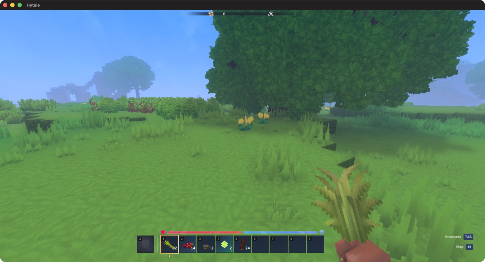

# Hytale na Macu z procesorem Intel

Hytale ma wersję na macOS tylko dla Apple Silicon. Natywny klient to
`Mach-O thin (arm64)`, a macOS nie tłumaczy arm64 na x86_64 (Rosetta działa
w drugą stronę), więc na Macu Intel ta wersja nie uruchomi się nigdy.

To repozytorium idzie inną drogą: uruchamia **windowsową** wersję gry pod Wine,
co na Macu Intel układa się nieoczekiwanie korzystnie.



> ## Stan: DZIAŁA - gra wchodzi do świata na Macu z procesorem Intel
>
> Hytale v0.7.4 działa pod Wine na MacBooku Pro 16,1 (2019) z Intel
> Core i7-9750H i Radeonem Pro 5300M, pod macOS 26 Tahoe - od menu po **wejście
> do świata jednoosobowego i na serwery multiplayer**. Potwierdzone na żywo:
>
> ```
> OpenGL driver: 4.1 ATI-7.1.6
> GPU Renderer: AMD Radeon Pro 5300M OpenGL Engine
> Built 76 GPU programs successfully.
> Quiche Stream connected to 127.0.0.1:…
> Player '<twoja-nazwa>' joined world 'default'
> Changing from Stage GameLoading to InGame
> ```
>
> Klucz całej układanki okazał się nie być techniczny, tylko w uruchomieniu
> przez **oficjalny launcher z zalogowanym kontem** - wtedy launcher sam wydaje
> klientowi token i startuje go z `--auth-mode authenticated`. Problemem było
> tylko to, że interfejs launchera pod Wine jest niewidoczny. Rozwiązanie:
> sterować nim przez port debugowania WebView2, którego DOM działa, choć obraz
> się nie rysuje. Użytkownik loguje się własnymi danymi w przeglądarce - niczego
> się nie obchodzi ani nie podrabia.
>
> Jak uruchomić (prosto): `./setup.sh`, raz zdobądź pliki gry z Windowsa, potem
> klikasz **Play Hytale** na Pulpicie. Pełna instrukcja krok po kroku jest niżej
> w sekcji **Szybki start**. Pierwszy raz wymaga zalogowania w przeglądarce;
> kolejne uruchomienia są automatyczne.
>
> ### Dokąd dochodzi
>
> **Działa w pełni, do rozgrywki włącznie:** uruchomienie, logowanie (token
> z launchera), menu główne, ekran wyboru świata, **wygenerowanie i wejście do
> świata jednoosobowego** oraz **wejście na serwery multiplayer**. Potwierdzone
> na żywo: `Player '<twoja-nazwa>' joined world 'default'`,
> `Changing from Stage GameLoading to InGame`, zero błędów kryptograficznych.
>
> ### Ostatni blocker: lokalny handshake mTLS (rozwiązany)
>
> Wejście do świata to połączenie klienta z serwerem przez QUIC z wzajemnym TLS
> (mTLS) - w singleplayer klient uruchamia własny, lokalny serwer, w multiplayer
> łączy się ze zdalnym. Klient .NET padał na:
>
> ```
> Failed to connect to 127.0.0.1:…  CryptographicException: 0x80090027
> ```
>
> `0x80090027` = `NTE_INVALID_PARAMETER`. Przez dezasemblację klienta i dynamiczny
> inline-hook (proxy `version.dll` + MinHook) namierzono **trzy luki w stosie CNG
> Wine 11.18**, nie jedną:
>
> 1. **`NCryptGetProperty`** nie zna wyliczanych właściwości klucza
>    (`Provider Handle`, `Algorithm Group`…) i zwraca `NTE_INVALID_PARAMETER`.
> 2. Round-trip **PKCS#12**, którym .NET normalizuje certyfikat klienta, pod Wine
>    daje klucz **mostkowany przez CAPI** - `RSACng` go odrzuca
>    („keys used with the RSACng algorithm must have an algorithm group of RSA").
> 3. Wine nie potrafi wyeksportować klucza w formacie **`PKCS8_PRIVATEKEY`**,
>    którego klient potrzebuje, by przekazać go bibliotece QUIC.
>
> Wszystkie trzy łata wtyczka **[`wine-fix/`](wine-fix/README.md)** - proxy
> `version.dll` ładowane do procesu klienta, które inline-hookuje funkcje CNG Wine
> (`ncrypt`/`crypt32`). Łata operuje **wyłącznie na własnym, efemerycznym kluczu
> klienta** (tym samym, który klient sam importuje); nie podrabia tokenów, nie
> wyłącza weryfikacji, nie rusza binarki gry. `play.sh` wgrywa ją automatycznie.
>
> > Katalogi `ncrypt-shim/` i `bcrypt-logger/` to **materiał historyczny** z drogi
> > do rozwiązania - zapis wcześniejszej, błędnej hipotezy „to bcrypt, nie da się
> > załatać z zewnątrz". Zostawione jako ślad śledztwa; nie są używane.

## Szybki start

**Czego potrzebujesz (szczerze):**

- Mac z procesorem **Intel** (to nie zadziała na Apple Silicon, czyli M1/M2/M3...).
- Darmowe **konto Hytale** (hytale.com) i dostęp do **plików gry z Windowsa**:
  z Boot Campa na tym Macu albo z innego peceta. Tego jednego kroku nie da się
  pominąć, bo plików gry nie wolno nam udostępniać.
- Kilka minut i trochę miejsca na dysku.

**Krok po kroku:**

1. **Pobierz to repozytorium.** W aplikacji Terminal (jest w każdym Macu) wpisz:

   ```bash
   git clone https://github.com/protostrange-lab/hytale-mac-intel.git
   cd hytale-mac-intel
   ```

   Albo na GitHubie kliknij zielony przycisk **Code → Download ZIP**, rozpakuj,
   i wejdź do tego folderu w Terminalu.

2. **Uruchom jedno polecenie**, które przygotuje wszystko (Wine, łatę i aplikację
   z ikoną):

   ```bash
   ./setup.sh
   ```

   Poczekaj do końca. Pierwszy raz pobiera sporo rzeczy, więc chwilę to trwa.

3. **Skopiuj pliki gry z Windowsa** na dysk widoczny z macOS. Dokładnie jak to
   zrobić: niżej w tym dokumencie, sekcja „Pliki gry wciąż zdobywasz z Windowsa raz"
   (i „Warte uwagi: podziel grę na pół", jeśli masz mało miejsca).

4. **Kliknij dwukrotnie „Play Hytale"** na Pulpicie. Pierwszy raz zaloguj się
   w przeglądarce swoim kontem. I już grasz. 🎮

   Chcesz mieć stały przycisk? Przeciągnij „Play Hytale" na Dock.

> Nie chcesz nic instalować ręcznie? `setup.sh` sam zainstaluje kompilator przez
> Homebrew. Jeśli nie masz Homebrew, poprosi Cię o jego instalację (https://brew.sh)
> i o `brew install mingw-w64`, a potem uruchom `./setup.sh` jeszcze raz.

Reszta tego dokumentu to szczegóły: dlaczego to działa, co zmierzono i jak jest
zbudowane. Do grania wystarczą cztery kroki powyżej.

---

## Dlaczego to ma szansę

1. **Hytale wymaga OpenGL 4.1.** Od Update 6 (sierpień 2026) to twarda bramka:
   klient kończy działanie od razu, jeśli sterownik zgłosi mniej.
2. **macOS daje dokładnie OpenGL 4.1.** Apple zamroziło GL na 4.1. Minimum gry
   i maksimum systemu to ta sama liczba - zapasu nie ma ani krzty.
3. **Na Macu Intel Wine nie tłumaczy procesora.** Windowsowa binarka x86_64
   działa na x86_64 natywnie. Z trzech wydanych buildów Hytale dwa
   (`windows/amd64`, `linux/amd64`) są dla tej architektury.
4. **Nie ma anty-cheata jądrowego.** EULA §6.1 wprost: „We do not deploy
   kernel-level anti-cheat", ochrona jest „primarily server-side, with limited
   client-side telemetry". Brak EAC i BattlEye usuwa najczęstszą przyczynę
   porażki Wine.

## Jak Hytale jest zbudowany

Wbrew temu, co krąży po internecie, nie ma silnika „Flow" - przepisywanie na
C++ porzucono w listopadzie 2025 i nie weszło do wydania. Wydany jest
„Legacy Engine":

| część | czym jest | co to znaczy dla Wine |
|---|---|---|
| klient | C#, skompilowany jako .NET NativeAOT | zwykła natywna binarka PE, **nie trzeba .NET w prefiksie** |
| serwer | Java, `HytaleServer.jar`, wymaga Javy 25+ | nawet gra jednoosobowa uruchamia osobny proces serwera |
| okno, wejście, dźwięk | SDL3 | powierzchnia, którą Wine obsługuje najlepiej |
| interfejs | NoesisGUI | - |
| launcher | Go 1.26.10 + Wails v2 na webview systemu | na Windows znaczy to WebView2, a ten pod Wine jest kapryśny |
| sieć | QUIC po UDP, port 5520 | natywna biblioteka quiche, zapas w czystej Javie (netty) |
| aktualizacje | wharf/butler z itch.io | łatki różnicowe |

Instalacja zajmuje około **8 GB**. Klient przyjmuje argumenty
`--app-dir`, `--user-dir`, `--java-exec`, `--auth-mode`, `--uuid`, `--name`,
czyli **da się go uruchomić wprost, bez launchera** - co omija kłopot
z WebView2. Nie ma natomiast żadnego przełącznika wyboru renderera.

## Co zostało zmierzone

MacBook Pro 16,1 (2019), Intel Core i7-9750H, AMD Radeon Pro 5300M 4 GB,
32 GB RAM, macOS 26.6.2 Tahoe (25G83), Wine 11.18 staging (osx64).

**Windowsowy `.exe` pod Wine, dwa konteksty obok siebie:**

```
--- kontekst domyslny (legacy) ---
GL_VERSION : 2.1 ATI-7.1.6          <-- ponizej bramki Hytale
--- kontekst 4.1 CORE, zazadany wprost ---
GL_VERSION : 4.1 ATI-7.1.6          <-- dokladnie na bramce
GL_RENDERER: AMD Radeon Pro 5300M OpenGL Engine
GLSL       : 4.10
rozszerzen : 46   max tekstura: 16384   max MSAA: 8
```

Te dwie liczby to sedno sprawy - patrz „Jedyne realne ryzyko" niżej.

**Pełny stos z Javą (połowa serwerowa gry):**

```
GL_VERSION : 4.1 ATI-7.1.6          OpenGL 4.1 : true
GL_RENDERER: AMD Radeon Pro 5300M OpenGL Engine
klatki     : 839 fps (clear+swap, bez vsync)    blad GL : 0
```

Windowsowy OpenJDK 21 startuje pod Wine bez przeszkód. Kontekst trafia na
**kartę dyskretną**, nie na Intel UHD 630 - ten byłby poniżej minimum gry.
Vulkan przez MoltenVK też działa (145 rozszerzeń), więc DXVK jest dostępny,
gdyby gdziekolwiek pojawił się Direct3D.

Odtworzysz to u siebie przez `./doctor.sh` (8 testów).

## Jedyne realne ryzyko: jeden bit

Zmierzona macierz tworzenia kontekstu pod Wine na tej maszynie:

| żądanie aplikacji | wynik |
|---|---|
| 4.1 core **z** `WGL_CONTEXT_FORWARD_COMPATIBLE_BIT_ARB` | **działa** |
| 4.1 core **bez** tego bitu | `NULL` |
| 4.1 compatibility | `NULL` |
| kontekst domyślny | GL 2.1 - Hytale zamyka się natychmiast |

macOS udziela kontekstu powyżej 3.2 wyłącznie w wariancie forward-compatible.
Wszystko zależy więc od tego, czy `HytaleClient.exe` ustawia ten jeden bit.
Odpowiedź daje dopiero posiadanie pliku klienta.

Gdyby nie ustawiał, mechanizm obejścia jest znany i sprawdzony przez innych:
projekt Hytale-Aurora-Shaders podkłada klientowi własny `opengl32.dll` obok
`HytaleClient.exe`. Taką samą podmianką można wymusić bit forward-compatible.

Uwaga na ślepy zaułek: `wine-glcore-interpose` naprawia tylko przypadek
kontekstu domyślnego, bo podpina się pod `CGLChoosePixelFormat`. Jawne żądanie
4.1 core bez tego bitu jest odrzucane wcześniej, po stronie procesora,
w `winemac.drv` - w dostarczonym `winemac.so` siedzi dosłownie komunikat
„OS X only supports forward-compatible 3.2+ contexts".

Drugie ryzyko jest nietechniczne: telemetria klienta jest „limited", ale
istnieje, a konfiguracja jest oficjalnie niewspierana. Nic nie wskazuje, by
ktokolwiek był za to karany, ale nie udawajmy, że środowisko jest niewidoczne.

## Użycie

```bash
./install.sh                  # Wine 11.18 staging + prefiks win64
./doctor.sh                   # sprawdza, czy ta maszyna rzeczywiście to potrafi
brew install mingw-w64        # kompilator do łaty CNG
(cd wine-fix && ./build.sh)   # buduje wine-fix/version.dll (łata CNG; play.sh ją wgra)
```

> Łata `wine-fix/version.dll` nie jest trzymana w repo jako binarka - zbuduj ją ze
> źródła powyższym `build.sh`. `play.sh` wgrywa ją automatycznie przy starcie i bez
> niej gra nie wejdzie do świata (patrz [`wine-fix/`](wine-fix/README.md)).

Potem pobierz launcher **dla Windows**. Sam launcher jest publiczny - konto
jest potrzebne dopiero do zalogowania się w nim i do licencji na grę:

```bash
curl -fL -o ~/Downloads/hytale-launcher-installer.exe \
  https://launcher.hytale.com/builds/release/windows/amd64/hytale-launcher-installer-latest.exe
./run-hytale.sh ~/Downloads/hytale-launcher-installer.exe
```

Buildy leżą pod przewidywalnymi adresami i same w sobie są dowodem na to,
dla kogo Hytale wychodzi:

```
.../builds/release/windows/amd64/hytale-launcher-installer-latest.exe
.../builds/release/linux/amd64/hytale-launcher-latest.flatpak
.../builds/release/darwin/arm64/hytale-launcher-latest.dmg     <-- tylko arm64
```

Instalator jest 32-bitowym stubem NSIS. Na macOS nie ma już kodu 32-bit, ale
**nowy WoW64 w Wine 11 go uruchamia** - sprawdzone. Instalator dociąga przy
okazji środowisko Edge WebView2 (ponad 700 MB), bo launcher jest aplikacją
Wails i bez niego nie narysuje interfejsu. Daj mu kilka minut.

| polecenie | po co |
|---|---|
| `./run-hytale.sh --log` | pełny log Wine i wypis błędów |
| `./run-hytale.sh --dxvk` / `--no-dxvk` | DXVK, gdyby pojawił się Direct3D 11 |
| `./run-hytale.sh --winecfg` | konfigurator Wine |
| `./run-hytale.sh --kill` | ubija zawieszony prefiks |

Prefiks musi leżeć na systemie plików z symlinkami (APFS, HFS+); na exFAT
i NTFS nie zadziała. Jeśli na dysku startowym ciasno:

```bash
WINEPREFIX=/Volumes/Gry/hytale ./install.sh
```

## Launcher pod Wine nie narysuje interfejsu (sprawdzone)

To nie jest przypuszczenie, tylko wynik. Instalator przechodzi do końca
(`exit=0`), wgrywa WebView2, launcher startuje i jego część w Go działa
bez zarzutu:

```
[WebView2] Environment created successfully
app initialized
network connectivity detected  status=online
loopback server starting  addr=127.0.0.1:64038
```

Powstaje okno 1020×640 z poprawnym paskiem tytułu - i **całkowicie białą
zawartością**. Renderer Chromium nie maluje nic. Próbowane bez skutku:
`--disable-gpu`, `--disable-gpu-compositing`, `--disable-software-rasterizer=0`,
`--disable-features=RendererCodeIntegrity`, `--no-sandbox`,
`--disable-dev-shm-usage`. Trzy uruchomienia, zrzuty okna identyczne co do bajta.

### Dlaczego nie da się tego obejść

Przyczyny są [opisane u Microsoftu](https://github.com/MicrosoftEdge/WebView2Feedback/issues/5720)
i są trzy, każda wystarczy sama:

1. Runtime dokleja `--in-process-gpu --use-gl=swiftshader` **jako ostatni**
   argument, a ta wartość została z Chromium usunięta. Inicjalizacja GL pada
   w `gl_factory.cc:110`, a że flaga jest ostatnia, nie da się jej nadpisać.
2. `output_device_backing.cc:150` woła `D3D11CreateDevice` z zahardkodowanym
   `D3D_DRIVER_TYPE_WARP`. Wine nie ma WARP-a (`d3d10warp.dll` nie istnieje),
   więc `E_INVALIDARG`.
3. Na macOS dochodzi brak `pGetDC` w `winemac.drv` (błąd Wine 35456), przez co
   rysowanie do okna potomnego między procesami i tak trafia w próżnię.

**DXVK też nie pomoże i to warto zapisać, bo w zgłoszeniu nie pada ani razu.**
Pomysł był dobry: DXVK tworzy urządzenie na Vulkanie niezależnie od żądanego
typu sterownika, więc blokada numer 2 powinna zniknąć. Na Macu nie zadziała
z innego powodu:

```
info:  Found device: Radeon RX 5500M (MoltenVK 0.2.2208)
info:    Skipping: Device does not support required feature 'geometryShader'
warn:  DXVK: No adapters found.
err:   Failed to initialize DXVK.
```

Metal nie ma shaderów geometrycznych, więc MoltenVK nie wystawia
`geometryShader`, którego DXVK 3.x wymaga bezwzględnie. To ograniczenie
platformy, nie kwestia konfiguracji. Po podmianie WebView2 przestaje się nawet
uruchamiać (`WebView2Process failed with kind 6`), więc **cofnij podmianę**.

### Co jednak działa: okno jest ślepe, ale nie głuche

Zgłoszenie mówi, że DOM strony żyje - produkowana jest tylko jedna klatka.
I rzeczywiście: sterując oknem z zewnątrz (CGEvent, Tab + Enter) udało się
raz uruchomić logowanie - launcher otworzył prawdziwą stronę
`accounts.hytale.com/login?flow=...` w przeglądarce systemowej. Wejście
dociera więc do strony.

Praktycznie to jednak za mało: bez obrazu nie wiadomo, co jest zaznaczone ani
w jakim stanie jest aplikacja, a każdy detektor sukcesu zawodzi (log launchera
milczy, `winebrowser` kończy się natychmiast po wywołaniu `open`, tytuły okien
przeglądarki zmieniają się same). Sterowanie na ślepo jest odtwarzalne mniej
więcej tak jak rzut monetą.

### Który shader nie powstaje i czy to boli

Na Windowsie kompilują się 77 programy GPU, pod Wine 76. Klient wypisuje
w logu pełną listę nazw, więc da się to porównać dokładnie zamiast zgadywać.
Różnica to **dokładnie jeden program**:

```
KBufferResolveProgram
```

Plik shadera to `KBufferResolveFS.glsl`. K-buffer to technika przezroczystości
niezależnej od kolejności rysowania - wymaga zapisu do obrazów z poziomu
shadera fragmentów, czyli `GL_ARB_shader_image_load_store`, które weszło do
core dopiero w OpenGL 4.2. macOS kończy się na 4.1 i tego rozszerzenia nie
wystawia, co zmierzyłem (patrz `doctor.sh`).

Co ważne, **silnik traktuje to jako opcję, nie wymóg**. W binarce klienta jest
linia konfiguratorów shaderów:

```
//@Configurators{USE_TRANSLUCENT:0,USE_OIT:0,USE_KBUFFER:0}
```

oraz osobne ustawienie `UseKBuffer`. Istnieją więc warianty bez K-buffera,
a `OITCompositeProgram`, `MapChunkAlphaBlendedProgram` i
`EntityAlphaBlendedBlockyModelProgram` kompilują się pod Wine bez zarzutu.
W `UserData/Settings.json` `RenderingSettings.Transparency` jest ustawione
na `0`, a klient mimo brakującego programu zgłosił „Built 76 GPU programs
**successfully**" i kontynuował start.

Praktyczny wniosek: jedyną graficzną ofiarą przeniesienia na macOS jest
wyższej jakości ścieżka przezroczystości. Spodziewaj się gorszego wyglądu tam,
gdzie kilka przezroczystych powierzchni nakłada się na siebie (woda za szkłem,
gęste listowie), a nie braku obrazu. Zastrzeżenie: nie udało się tego
potwierdzić w ruchu, bo gra zatrzymuje się wcześniej na tokenie.

Jedyne inne ostrzeżenie graficzne w logu jest nieszkodliwe:

```
Expected GL extension GL_ATI_meminfo is not available.
```

To tylko raportowanie zajętości pamięci karty.

### Przy okazji: błąd Wine, który dotyka każdej aplikacji .NET 9+

W logu klienta pojawia się jeszcze to:

```
ERROR|AuthManager|Failed to generate certificate
  Pkcs12LoadLimitExceededException: The PKCS#12/PFX violated the 'MacIterationLimit' limit.
```

⚠️ **To NIE jest blokada Hytale** - sprawdź znaczniki czasu. Wyjątek kończący
grę pada o 23:39:42.30 (brak tokenu), a ten błąd o 23:39:43.15, sekundę
później, w osobnym zadaniu generowania certyfikatu. Łatwo je pomylić, bo leżą
obok siebie w logu.

Przyczyna jest jednak realna i warta zapisania, bo dotyczy znacznie szerszego
kręgu programów. Klient tworzy certyfikat samopodpisany, eksportuje go do
PKCS#12 i zaraz wczytuje z powrotem. Pod Wine eksport idzie przez `crypt32`,
które woła GnuTLS, a GnuTLS zapisuje `PKCS12_ITER_COUNT` równe **600000**.
Prawdziwe windowsowe `crypt32` zapisuje **2000**. Tymczasem .NET od wersji 9
odrzuca przy wczytywaniu wszystko powyżej **300000** (`MacIterationLimit`).

Wine ignoruje tu również wartość z rejestru, którą Windows honoruje:

```
HKLM\Software\Microsoft\Windows\CurrentVersion\PFX\PasswordIterationCount
```

Efekt: **każda aplikacja .NET 9+ pod Wine, która przepuszcza certyfikat przez
PFX w tę i z powrotem, wywróci się w tym miejscu** - niezależnie od Hytale.
To nadaje się na zgłoszenie do WineHQ (komponent `crypt32`).

Obejścia istnieją - przebudowa GnuTLS z `--with-pkcs12-iter-count=2000`
podstawiona przez `DYLD_LIBRARY_PATH`, albo łata na `crypt32` w Wine - ale
w przypadku Hytale nie ma sensu ich stosować, bo gra zatrzymuje się wcześniej,
na braku tokenu.

### Launcher nie ma też użytecznego CLI

Sprawdzone, nie zgadywane. Launcher parsuje argumenty pakietem `flag` z Go,
więc nieznana flaga daje `flag provided but not defined: -x`. To wyrocznia:
flaga zdefiniowana nie wywoła błędu.

⚠️ **Pułapka metodologiczna, na którą sam się nabrałem:** przy czterech
sekundach na próbę połowa flag wyglądała na istniejące. Przy ośmiu sekundach
i z dodanymi kontrolami (flagami zmyślonymi) okazało się, że **nie istnieje
żadna** - wcześniejsze „trafienia" to był wyścig z czasem startu procesu.
Jeśli powtarzasz takie badanie, zawsze dorzuć kontrolę.

Nie istnieją: `--login`, `--offline`, `--no-gui`, `--launch-game`, `--silent`,
`--auth-mode`, `--app-dir`, `--java-exec`, `--headless`, `--play`, `--game`,
`--uuid`, `--name`, `--session-token`, `--identity-token`, `--offline-token`.
`-h` i `--help` nie wypisują nic. Launcher jest wyłącznie graficzny.

### Danych konta z Windowsa nie przeniesiesz

`account.dat` jest zaszyfrowany i związany z maszyną. Podłożony pod Wine daje:

```
ERROR unable to read account file  error="cipher: message authentication failed"
```

Tak ma być i nie ma tu czego obchodzić.

### Rozwiązanie: sterować launcherem przez DevTools (działa)

Uruchamianie samego klienta z pominięciem launchera **nie wystarczy** - nawet
tryb `--auth-mode offline` kończy się na:

```
Offline mode requires HYTALE_OFFLINE_TOKEN environment variable
```

Token wydaje tylko launcher po zalogowaniu. A launcher pod Wine się nie rysuje.
Przełom: jego **DOM żyje**, mimo że obraz nie. WebView2 ma protokół debugowania
(CDP), który można włączyć przez politykę rejestru - i tej drogi Wails nie
nadpisuje (w przeciwieństwie do zmiennej środowiskowej):

```
HKLM\SOFTWARE\Policies\Microsoft\Edge\WebView2\AdditionalBrowserArguments
  = --remote-debugging-port=9222 --remote-allow-origins=*
```

Z portem 9222 można czytać DOM i klikać elementy po nazwie klasy CSS - bez
zgadywania pikseli. Łańcuch, który robi `play.sh`:

1. klik `button.login__sign-in-button` → launcher otwiera prawdziwy OAuth
   Hypixela w przeglądarce systemowej;
2. **użytkownik loguje się własnymi danymi** (albo sesja w przeglądarce jest
   jeszcze ważna i OAuth domyka się sam);
3. callback wraca na serwer loopback launchera, launcher dostaje token
   (`loopback result received has_token=true`) i zapisuje `account.dat`
   czytelny pod Wine;
4. klik `button.hybutton-split__main` (PLAY) → launcher startuje klienta
   z tokenem w środowisku i `--auth-mode authenticated --uuid … --name …`.

Niczego się nie obchodzi: to oficjalny launcher, Twoje konto, Twój token,
Twoje logowanie. Wkład tego repo to obejście **błędu renderowania** launchera
oraz **uzupełnienie braków kryptografii Wine** (interop, patrz
[`wine-fix/`](wine-fix/README.md)) - nie obejście bramki uwierzytelniania.

**Dwie pułapki ścieżek**, które `play.sh` załatwia (bez nich launcher zgłasza
„Assets.zip does not exist" albo klient nie znajduje danych):

- `D:` w prefiksie musi wskazywać tam, gdzie leży gra (patchline używa `D:\`).
- Instalacja z Windowsa ma zapisaną na sztywno ścieżkę
  `C:\Users\<WindowsowaNazwa>\AppData\Roaming\Hytale`. Pod Wine użytkownik
  nazywa się inaczej, więc trzeba dowiązać też tę ścieżkę do gry
  (`HYTALE_WIN_USER`).

### Pliki gry wciąż zdobywasz z Windowsa raz

Launcher pod Wine uruchomi i zaloguje grę, ale jego ekran pobierania to też
WebView2 - więc **pierwsze pobranie plików robisz na prawdziwym Windowsie**
(Boot Camp lub inny komputer) na partycję widoczną z macOS (exFAT). Potem już
tylko `play.sh`. Aktualizacje gry analogicznie: pobierasz na Windowsie, grasz
na macOS.

## Warte uwagi: podziel grę na pół

Nawet gra jednoosobowa uruchamia osobny serwer w Javie, i to **ta połowa jest
cięższa dla procesora** (generowanie świata, logika wokseli, NPC). Nie ma
powodu, żeby pchać ją przez Wine - Java na macOS x86_64 istnieje i działa
natywnie. Klient pod Wine, serwer natywnie, połączenie przez `localhost:5520`.
Wymaga dołączania po adresie zamiast przycisku gry jednoosobowej, bo ten sam
uruchamia serwer jako proces potomny przez `--java-exec`.

To najbardziej obiecująca optymalizacja tej konfiguracji i nie jest jeszcze
zrobiona.

## Drogi odrzucone i dlaczego

| droga | wynik |
|---|---|
| natywny klient macOS | **niemożliwa.** `Mach-O thin (arm64)`, brak tłumaczenia arm64→x86_64. Nie ma czego naprawiać. |
| WineMetalGL (OpenGL 4.6 na Metalu) | **nie dotyczy Intela.** Projekt jest wyłącznie dla Apple Silicon; jego build x86_64 istnieje po to, by Wine x86_64 chodziło pod Rosettą na Apple Silicon. |
| Parallels Desktop | Parallels 27 (sierpień 2026) **porzucił Intela** i Boot Camp. Intel został na wersji 26. |
| Linux x64 w maszynie wirtualnej | atrakcyjna na papierze (natywny build, Flatpak), ale trzeba dowieźć gościowi OpenGL 4.1. |
| VMware Fusion 26H1 | **realny zapas.** Wspiera hosta Intel pod Tahoe i dokumentuje w gościu OpenGL 4.3, czyli powyżej bramki. Umie też **uruchomić istniejącą partycję Boot Camp jako maszynę wirtualną**, co omija brak miejsca na dysku. |
| CrossOver | CrossOver 26 to **ostatnia wersja ze wsparciem Intela**; 27 je usuwa. |

## Zegar tyka

macOS 26 Tahoe to ostatni macOS dla procesorów Intel - macOS 27 kończy ich
wsparcie. CrossOver 27 i Parallels 27 już Intela porzuciły. Cokolwiek się tu
zrobi, warto zrobić teraz.

Osobna sprawa: Hypixel Studios **nigdy publicznie nie odmówiło** wersji na Maki
Intel. Ich wpis z 1 grudnia 2025 mówi o zamiarze wsparcia „older Macs (Intel
Processors)" obok „newer Macs with M1+". Rozpowszechnione twierdzenie o odmowie
pochodzi z pojedynczej strony bez źródła pierwotnego. Zamiar jest sprzed
dziesięciu miesięcy i bez widocznych postępów, ale formalnie nie został
wycofany - warto o niego dopytywać, zamiast zakładać, że sprawa jest zamknięta.

## Wkład

Jeśli uruchomisz to u siebie, zgłoś: model Maca, procesor, GPU, wersję macOS,
wersję Wine, wyjście `./doctor.sh` i czy gra faktycznie ruszyła - a jeśli nie,
na czym się zatrzymała. Najbardziej brakuje potwierdzeń z innych konfiguracji,
zwłaszcza z Maców z GPU Nvidii.

Warto też wysłać zgłoszenie do [WineHQ AppDB](https://appdb.winehq.org/).

## Co to nie jest

Repozytorium nie zawiera, nie pobiera i nie rozprowadza plików gry ani nie
obchodzi uwierzytelniania. Potrzebne jest własne konto i licencja Hytale. To
wyłącznie konfiguracja warstwy zgodności (Wine) plus łata interop na braki Wine
- ten sam gatunek rzeczy co przepisy instalacyjne Lutrisa czy zgłoszenia do WineHQ.

Wtyczka `wine-fix/version.dll` to proxy biblioteki systemowej ładowane **do
procesu klienta**, które inline-hookuje funkcje kryptograficzne **Wine**
(`ncrypt`/`crypt32`), by uzupełnić ich braki - **binarka gry pozostaje
nietknięta**. Łata działa wyłącznie na własnym, efemerycznym kluczu klienta;
nie podrabia tokenów i nie wyłącza żadnej weryfikacji. Szczegóły i granice:
[`wine-fix/README.md`](wine-fix/README.md).
